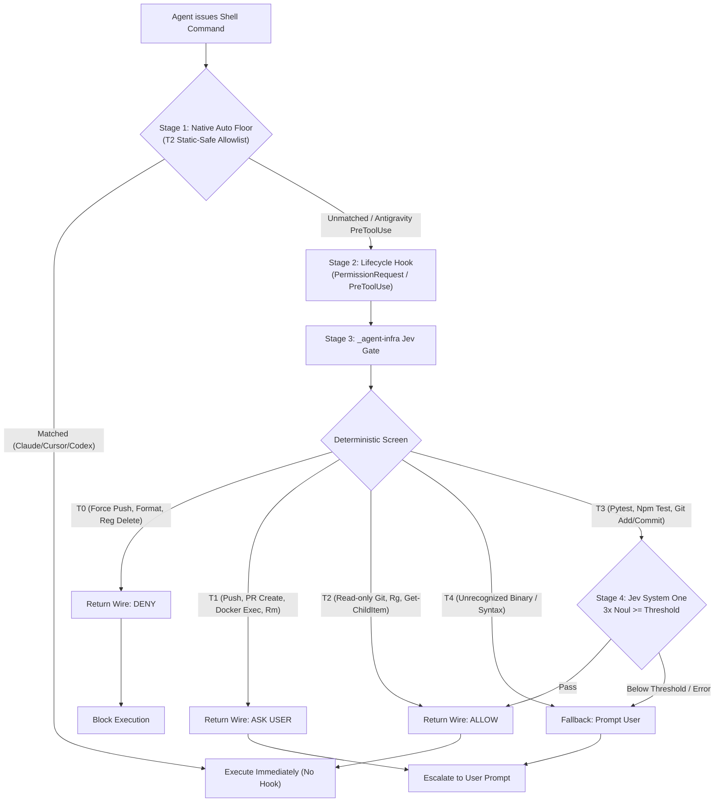
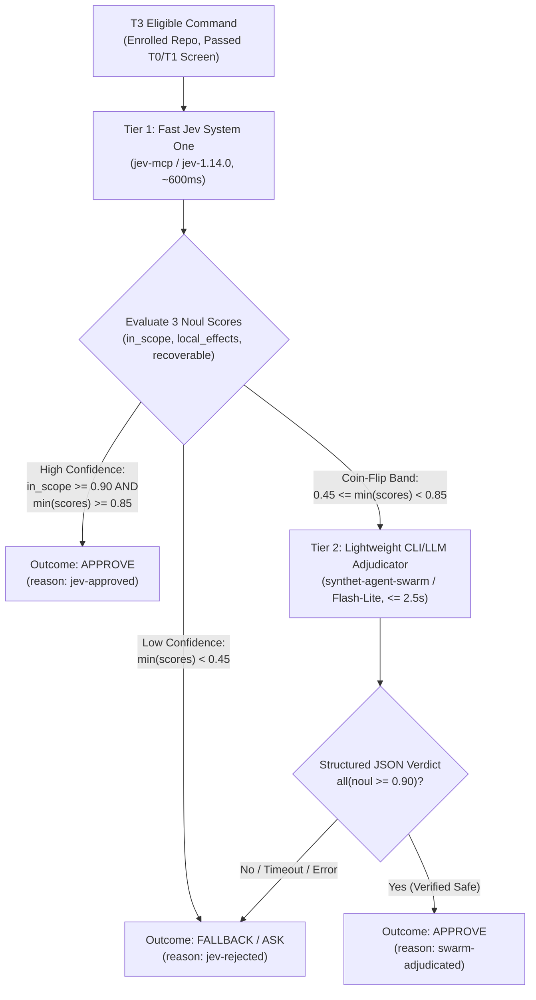

# Full Cross-Harness Permission Inventory, Live Telemetry Analysis & Governance Architecture

> **Canonical Reference Document**  
> **Scope:** OpenAI Codex, Anthropic Claude Code, Cursor (IDE & CLI), xAI Grok CLI, Google Antigravity (IDE & CLI), `D:\Projects\*` Project Repositories, and the `D:\Projects\_agent-infra` Control Plane.  
> **Companion Specification:** [`docs/centralized-permissions.md`](centralized-permissions.md)

---

## 1. Executive Summary & Master Cross-Harness Matrix

Modern multi-agent software engineering across Windows and WSL2 utilizes five distinct coding harnesses: **Claude Code**, **OpenAI Codex**, **Cursor (IDE & CLI)**, **Google Antigravity (IDE & CLI)**, and **xAI Grok CLI**. Historically, each harness evolved an isolated, incompatible permission model—ranging from TOML prefix rules and SQLite reactive state blobs to JSON glob lists and lifecycle hooks.

Left unmanaged, interactive "Always Allow" approvals caused severe **configuration drift and security rot**:
- **1,146** accumulated prefix rules in Codex (`rules/default.rules`).
- **1,080** one-off command grants in Antigravity CLI (`settings.json`), plus home-root workspace trust (`C:\Users\dmnsy`).
- **884** `yoloCommandAllowlist` entries in Cursor IDE (`state.vscdb`), including raw shells (`cmd`, `powershell`) and parser fragments (`}`, `$_`).
- **264** project-local allow rules scattered across `.claude/settings.local.json` files in `D:\Projects`.

To unify governance, the workstation deploys a **Centralized Permission Gate** housed in `D:\Projects\_agent-infra\jev`. Every harness is configured with a deterministic native floor (blocking **T0** catastrophic commands, prompting on **T1** high-risk mutations, and auto-allowing **T2** read-only inspections) while routing borderline/project-execution commands (**T3**) through lifecycle hooks to the Jev System One semantic engine.

### 1.1 Master Cross-Harness Comparison Matrix

| Dimension | Anthropic Claude Code | OpenAI Codex | Cursor (CLI & IDE) | Google Antigravity (CLI & IDE) | xAI Grok CLI |
|---|---|---|---|---|---|
| **Global Config Path** | `~/.claude/settings.json` | `~/.codex/config.toml`<br>`~/.codex/rules/default.rules` | `~/.cursor/cli-config.json`<br>`~/.cursor/permissions.json`<br>`%APPDATA%\Cursor\...\state.vscdb` | `~/.gemini/antigravity-cli/settings.json`<br>`~/.gemini/config/config.json`<br>`~/.gemini/trustedFolders.json` | `~/.grok/config.toml`<br>`~/.grok/trusted_folders.toml` |
| **Global Hook Path** | `~/.claude/settings.json` (`hooks` key) | `~/.codex/hooks.json` | `~/.cursor/hooks.json` | `~/.gemini/config/hooks.json` | *(Configured via plugin/hook specs)* |
| **Project Config Path** | `<repo>/.claude/settings.json`<br>`<repo>/.claude/settings.local.json` | `<repo>/.codex/config.toml` | `<repo>/.cursor/rules/*.mdc`<br>`<repo>/.cursor/mcp.json` | `<repo>/.agents/rules/*.md`<br>`<repo>/.agents/mcp_config.json` | `<repo>/.grok/` *(optional)* |
| **Default Approval Mode** | `"defaultMode": "auto"` | `approval_policy = "on-request"`<br>`approvals_reviewer = "auto_review"` | `"approvalMode": "auto-review"` | `"agentMode": "auto"` | `permission_mode = "auto"`<br>`yolo = false` |
| **Sandbox Mechanism** | Native OS / WSL boundary | `sandbox_mode = "workspace-write"` | Optional CLI sandbox (disabled on Win) | `enableTerminalSandbox: true`<br>`allowNonWorkspaceAccess: false` | None (host execution) |
| **Rule Syntax** | `Bash(git diff:*)`<br>`PowerShell(rg:*)`<br>`Read(**/.env)` | `prefix_rule(pattern=["git", "push"], decision="prompt")` | CLI: `Shell(git status)`<br>IDE: prefix tokens in `yoloCommandAllowlist` | `command(git status:*)`<br>`read_file(C:\path)`<br>`mcp(server/tool)` | `Bash(git status *)`<br>`Read(~/.ssh/**)` |
| **Hook Intercept Event** | `PermissionRequest` (`Bash\|PowerShell`)<br>`PreToolUse` (advisory) | `PermissionRequest` | `beforeShellExecution`<br>`beforeMCPExecution` | `PreToolUse` (`run_command\|ask_permission`) | `PreToolUse` |
| **Can Hook Auto-Approve?** | **Yes** (`decision.behavior = "allow"`) | **Yes** (`decision.behavior = "allow"`) | **Yes** (`permission = "allow"`) *(CLI only)* | **Yes** (`decision = "allow"`) | **No** (Wire only supports `deny`/`ask`/`defer`) |
| **Fail-Closed Fallback** | `{}` (Native auto/dialog prompt) | `{}` (Native reviewer/dialog prompt) | `{"permission": "ask"}` (`failClosed: true`) | `{"decision": "ask"}` / `"force_ask"` | `{"decision": "ask"}` |

---

## 2. Reality vs. Intention: Live Telemetry & Failure Mode Analysis

A core objective of this audit is comparing the **intended architectural flow** against **empirical reality** observed in live session transcripts, harness databases, and the central SQLite audit log (`D:\Projects\_agent-infra\jev\data\state.db`).

### 2.1 The Architectural Intention

The permission architecture was designed around a frictionless four-stage funnel:
1. **Default to `auto` whenever possible:** Harnesses run in `auto` / `auto-review` mode with a curated **T2** native allowlist so routine read-only operations (`git status`, `rg`, `Get-ChildItem`) execute instantaneously without hook overhead.
2. **Route non-trivial commands via Hooks to Jev:** When a command is not pre-approved by the static T2 floor (or when `PreToolUse` / `PermissionRequest` triggers), the harness invokes `jev_engineering.permission hook --harness <name>`.
3. **Deterministic Screen + Semantic Jev Gate:**
   - **T0 (Hard Deny)** and **T1 (Human Ask)** are intercepted deterministically; Jev is never called and cannot override them.
   - **T3 (Project Builds, Tests, Local Scripts, Git Bookkeeping)** are sent to Jev System One (`jev-1.14.0`), evaluating three `noul` questions (`in_scope`, `local_effects`, `recoverable`).
4. **Respect Decision — Apply or Escalate:** If Jev scores meet the threshold ($\ge 0.98$), the hook returns a wire approval and the command runs silently. Otherwise, it falls back to the native user prompt.



### 2.2 Empirical Reality from Live Database & 30-Day Transcript Mining

We queried two primary empirical datasets:
1. **`D:\Projects\_agent-infra\jev\data\state.db` (`permission_audit` table):** 297 live hook evaluations recorded after deploying the gate.
2. **`D:\Projects\_agent-infra\jev\reports\tier_review_30d.md` & `catalog_30d.json`:** 54,303 total tool calls (31,541 shell commands across 3,754 unique command heads) mined from 30 days of transcripts across Claude Code, Codex, Cursor, Antigravity, and Grok.

#### Dataset A: 30-Day Mined Transcript Distribution (`tier_review_30d.md`)

| Tier | Policy Meaning | Unique Command Heads | Total Observed Calls | Share of Shell Calls | Top Observed Commands & Harnesses |
|---|---|---|---|---|---|
| **T0** | Hard Deny | 3 | 5 | 0.02% | `diskpart` (cursor: 3), `Set-ExecutionPolicy` (cursor: 1) |
| **T1** | Human Ask | 879 | 2,884 | 9.14% | `docker exec` (438), `git push` (138), `curl` (57), `Invoke-WebRequest` (73), `Stop-Process` (34), `gh pr create` (29) |
| **T2** | Static-Safe Allow | 1,627 | 20,575 | 65.23% | `git status/diff/log`, `rg`, `Get-ChildItem`, `Select-String`, `ls`, `cat` |
| **T3** | Jev Decides | 62 | 4,550 | 14.43% | `python <script>` (1,047), `python -c` (948), `node <script>` (278), `uv run python` (228), `git add` (214), `pytest` (212), `git commit` (183) |
| **T4** | Unclassified (Prompt) | 1,183 | 3,527 | 11.18% | Complex PowerShell pipelines, custom binaries, unquoted paths |
| **n/a** | Non-Shell MCP/Tools | 66 | 22,762 | *(Non-shell)* | `Read`, `Edit`, `Write`, `Grep`, MCP calls |

#### Dataset B: Live Gate Telemetry in `state.db` (`permission_audit`)

| Harness | Tier | Outcome | Reason | Count | Mean Latency | Jev Called? |
|---|---|---|---|---|---|---|
| `antigravity` | **T2** | `approve` | `static-safe` | 155 | ~18 ms | No (0) |
| `antigravity` | **T1** | `ask` | `human-required` | 10 | ~15 ms | No (0) |
| `antigravity` | **T0** | `deny` | `hard-deny` | 1 | ~12 ms | No (0) |
| `antigravity` | **T3** | `fallback` | `jev-below-threshold` | 55 | ~680 ms | **Yes (55)** |
| `antigravity` | **T3** | ` approve` | `jev-approved` | **0** | — | — |
| `antigravity` | **T4** | `fallback` | `unclassified` | 76 | ~16 ms | No (0) |
| `claude` | *All* | — | *(No live records)* | **0** | — | — |
| `codex` | *All* | — | *(No live records)* | **0** | — | — |
| `cursor` | *All* | — | *(No live records)* | **0** | — | — |
| `grok` | *All* | — | *(No live records)* | **0** | — | — |

### 2.3 Root-Cause Diagnosis: The 4 Systemic Discrepancies

Analyzing the live telemetry exposes four major gaps between the intended design and live runtime behavior:

#### Discrepancy 1: The `0.98` Threshold Wall (0% T3 Auto-Approval Rate)
In `permission-policy.json`, the threshold is set to `"threshold": 0.98`, and `gate.py` requires **all three** Noul questions (`in_scope`, `local_effects`, `recoverable`) to score $\ge 0.98$:
```python
if all(s >= policy.threshold for s in scores.values()):
    v.outcome, v.reason = "approve", "jev-approved"
```
In live `state.db` records, `jev-1.14.0` evaluated 55 genuine T3 development commands and returned the following probability distributions:

| Live Command Executed in Antigravity | `in_scope` | `local_effects` | `recoverable` | Gate Verdict |
|---|---|---|---|---|
| `npm test` | `0.94` | `0.83` | `0.62` | **Fallback (Prompted User)** |
| `npm run test:run` | `0.91` | `0.80` | `0.57` | **Fallback (Prompted User)** |
| `npx tsc -p electron/tsconfig.json` | `0.93` | `0.87` | `0.82` | **Fallback (Prompted User)** |
| `npx eslint electron/exportExif.test.ts` | `0.94` | `0.86` | `0.85` | **Fallback (Prompted User)** |
| `npx vitest run electron/exportExif.test.ts` | `0.91` | `0.82` | `0.78` | **Fallback (Prompted User)** |
| `python .claude/skills/export-chat/scripts/export_chat.py ...` | `0.71` | `0.77` | `0.64` | **Fallback (Prompted User)** |

**Why this happens:** Semantic Noul models treat arbitrary test suites (`npm test`, `vitest`) or script invocations (`python ...`) as opaque executables that *could* theoretically modify local files or state, so `recoverable` and `local_effects` naturally land in the **0.57–0.87** band (coin-flip to moderate confidence). Because $0.87 < 0.98$, **100% of T3 calls failed closed to a user prompt.**

#### Discrepancy 2: The Native Auto-Memorization Trap (Config Pollution)
Because 100% of T3 commands and 76 T4 commands fell back to the user dialog in Antigravity, the user had to click **"Allow"** in the UI over 130 times in 24 hours.
- When a user approves a fallback prompt in **Antigravity** or **Cursor IDE**, the native client **permanently appends the exact command string** to its global config (`~/.gemini/antigravity-cli/settings.json` or Cursor `state.vscdb`).
- Running `python -m scripts.manage_permissions plan` today revealed that Antigravity's `settings.json` had already re-accumulated **82 one-off command strings** (including hardcoded scratchpad paths and multi-line PowerShell blocks), flipped `"allowNonWorkspaceAccess": true`, and re-added `"C:\\Users\\dmnsy"` to `trustedWorkspaces`.

#### Discrepancy 3: T4 Regex Path Blindspots
76 benign commands in Antigravity bypassed Jev entirely because `grammar.py` classified them as **T4 (`unclassified`)**:
1. **Global Skill & Brain Scratch Scripts:** Commands like `python "C:\Users\dmnsy\.gemini\antigravity-cli\skills\export-chat\scripts\export_chat.py"` or `python C:\Users\dmnsy\.gemini\antigravity-cli\brain\<uuid>\scratch\script.py` failed the `repo-scripts` and `scratch-scripts` regexes, which only matched relative paths (`scripts/...`, `.claude/skills/...`) or `%TEMP%` paths—not `~/.gemini/antigravity-cli/brain/...` or `~/.claude/skills/...`.
2. **`git -C <path>` Flags:** Read-only git commands using `-C` (e.g., `git -C D:\Projects\image-scoring-skills status --porcelain`) failed the `T2:git-read` regex (`^git\s+(?:status|diff|...)`), which did not allow a leading `-C <dir>` flag, whereas `T1:git-push` (`\bgit\s+(?:-C\s+\S+\s+)?push\b`) explicitly accounted for `-C`.
3. **PowerShell Variable Assignment Pipelines:** Wrapped commands like `pwsh -NoProfile -Command "$lines = Get-Content ..."` unwrapped to `$lines = ...`, which failed to match `T2:ps-read` and fell through as `wrap:unknown:$lines`.

#### Discrepancy 4: The Cross-Harness Hook Execution Gap (Claude, Codex, Cursor)
Why did `state.db` record 297 calls from Antigravity and **0 calls** from Claude Code, Codex, and Cursor?
1. **Claude Code:**
   - **Competing Unscoped Hook:** In `~/.claude/settings.json`, `PermissionRequest` contains two entries: first, an unscoped Warp notification hook (`on-permission-request.ps1` with no `matcher`), and second, the Jev gate hook (`matcher: "Bash|PowerShell"`).
   - **Internal `autoMode` Bypass:** Claude Code's native `autoMode` classifier (configured in `~/.claude/settings.json` under `"autoMode"`) evaluates commands internally using Anthropic's cloud classifier before `PermissionRequest` is ever emitted. `PermissionRequest` only fires when Claude decides it must show a permission dialog to the user.
   - **PreToolUse Separation:** Claude's `PreToolUse` hook calls `hook-pre-tool.ps1` (`jev_engineering.hook pre-tool`), which logs to `metrics.jsonl` and `decisions` table, **not** `permission_audit`.
2. **OpenAI Codex:**
   - **Built-in `auto_review` + Sandbox:** With `approval_policy = "on-request"`, `approvals_reviewer = "auto_review"`, and `sandbox_mode = "workspace-write"`, Codex executes commands inside its Windows workspace sandbox and uses its built-in reviewer rather than firing external `PermissionRequest` hooks unless a command requests sandbox escalation (`with_escalated_permissions: true`).
   - **Hook Trust Flag:** Codex CLI requires persisted hook trust or `--dangerously-bypass-hook-trust` to execute `.codex/hooks.json`.
3. **Cursor IDE vs. Cursor CLI:**
   - `~/.cursor/hooks.json` (`beforeShellExecution`) is respected by the **Cursor CLI agent**, but the **Cursor Desktop IDE** (Electron) evaluates terminal tool calls against its internal SQLite `state.vscdb` (`yoloCommandAllowlist`) and native `autoRun` LLM instructions.

---

## 3. User / Global-Level Configuration Forensic Inventory

This section provides the exact file locations, active schemas, and annotated configuration snippets for every harness at the user/global level (`C:\Users\dmnsy\`).

### 3.1 Anthropic Claude Code (`~/.claude/`)

Claude Code consolidates global permissions, model preferences, `autoMode` cloud classifier context, MCP servers, and lifecycle hooks inside a single file: **`C:\Users\dmnsy\.claude\settings.json`**.

#### Active Global Configuration (`C:\Users\dmnsy\.claude\settings.json`)
```json
{
  "permissions": {
    "defaultMode": "auto",
    "allow": [
      "Bash(git status:*)",
      "PowerShell(git status:*)",
      "Bash(git diff:*)",
      "PowerShell(git diff:*)",
      "Bash(git log:*)",
      "PowerShell(git log:*)",
      "Bash(rg:*)",
      "PowerShell(rg:*)",
      "Bash(Get-Content:*)",
      "PowerShell(Get-Content:*)",
      "Bash(Get-ChildItem:*)",
      "PowerShell(Get-ChildItem:*)",
      "Bash(Select-String:*)",
      "PowerShell(Select-String:*)",
      "Bash(gh pr view:*)",
      "PowerShell(gh pr view:*)",
      "Bash(docker ps:*)",
      "PowerShell(docker ps:*)",
      "Read(**/.env.example)"
    ],
    "ask": [
      "Bash(git push:*)",
      "PowerShell(git push:*)",
      "Bash(git reset --hard:*)",
      "PowerShell(git reset --hard:*)",
      "Bash(gh pr create:*)",
      "PowerShell(gh pr create:*)",
      "Bash(docker exec:*)",
      "PowerShell(docker exec:*)",
      "Bash(npm install:*)",
      "PowerShell(npm install:*)",
      "Bash(Remove-Item:*)",
      "PowerShell(Remove-Item:*)",
      "Bash(curl:*)",
      "PowerShell(curl:*)"
    ],
    "deny": [
      "Bash(git push --force:*)",
      "PowerShell(git push --force:*)",
      "Bash(Format-Volume:*)",
      "PowerShell(Format-Volume:*)",
      "Bash(Set-ExecutionPolicy:*)",
      "PowerShell(Set-ExecutionPolicy:*)",
      "Bash(reg delete:*)",
      "PowerShell(reg delete:*)",
      "Bash(git config extensions.worktreeConfig:*)",
      "Read(~/.ssh/**)",
      "Read(~/.aws/**)",
      "Read(~/.codex/auth.json)",
      "Read(~/.gemini/oauth_creds.json)",
      "Read(~/.claude/.credentials.json)",
      "Read(**/.env)",
      "Read(**/secrets.json)",
      "Edit(~/.ssh/**)",
      "Edit(**/.env)",
      "Edit(**/secrets.json)"
    ]
  },
  "hooks": {
    "PermissionRequest": [
      {
        "hooks": [
          {
            "type": "command",
            "command": "pwsh -NoProfile -File \"C:/Users/dmnsy/.claude/hooks/warp/on-permission-request.ps1\""
          }
        ]
      },
      {
        "matcher": "Bash|PowerShell",
        "hooks": [
          {
            "type": "command",
            "command": "uv run --project D:\\Projects\\_agent-infra\\jev python -m jev_engineering.permission hook --harness claude",
            "timeout": 12
          }
        ]
      }
    ],
    "PreToolUse": [
      {
        "hooks": [
          {
            "type": "command",
            "command": "pwsh -NoProfile -File \"D:/Projects/_agent-infra/jev/scripts/hook-pre-tool.ps1\"",
            "timeout": 15
          }
        ]
      }
    ],
    "UserPromptSubmit": [
      {
        "hooks": [
          {
            "type": "command",
            "command": "pwsh -NoProfile -File \"D:/Projects/_agent-infra/jev/scripts/hook-prompt.ps1\"",
            "timeout": 15
          }
        ]
      }
    ]
  },
  "autoMode": {
    "allow": [
      "$defaults",
      "Bash(ruff check:*) in D:\\Projects\\image-scoring-pipeline",
      "Bash(wsl -e bash -lc \"python -m pytest -m 'not gpu and not db and not ml'*\") in D:\\Projects\\image-scoring-pipeline"
    ],
    "soft_deny": [
      "$defaults",
      "Writes to files matching *prod*.json or *prod*.py under reports/ or scripts/research/ in this repo"
    ],
    "environment": [
      "### Org-wide",
      "**Organization**: None configured — GitHub user `synthet` (personal account, not an org)",
      "**Secrets management**: Local files only — `secrets.json` (git-ignored), `.env`/.env.* variants (git-ignored)"
    ]
  }
}
```

#### Key Mechanics in Claude Code:
1. **Dual Shell Tool Names:** On Windows, Claude Code may invoke either `Bash` (via Git Bash / WSL) or `PowerShell`. Therefore, `render_claude()` emits every rule twice (`Bash(<prefix>:*)` and `PowerShell(<prefix>:*)`).
2. **Precedence Order:** `deny` $\to$ `ask` $\to$ `allow` $\to$ `autoMode` classifier $\to$ `PermissionRequest` hook $\to$ interactive user prompt.
3. **Read/Edit File Protection:** Unlike Codex or Cursor CLI, Claude Code supports fine-grained `Read(...)` and `Edit(...)` glob rules, allowing `Read(**/.env.example)` as an explicit exception while denying `Read(**/.env)`.

---

### 3.2 OpenAI Codex (`~/.codex/`)

Codex splits its global configuration across three files under **`C:\Users\dmnsy\.codex\`**:
1. **`config.toml`**: Top-level approval policy, sandbox mode, trusted project paths, and MCP server definitions.
2. **`rules/default.rules`**: Starlark-style `prefix_rule(...)` declarations for direct binary invocations.
3. **`hooks.json`**: Lifecycle hook definitions (`PermissionRequest`).

#### 1. `C:\Users\dmnsy\.codex\config.toml`
```toml
approval_policy = "on-request"
approvals_reviewer = "auto_review"
sandbox_mode = "workspace-write"

personality = "pragmatic"
model = "gpt-5.4"
model_reasoning_effort = "high"

# Per-project trust declarations (29 projects enrolled)
[projects.'D:\Projects\synthet-code-framework']
trust_level = "trusted"

[projects.'D:\Projects\jev-mcp']
trust_level = "trusted"

# MCP server configuration with pruned write auto-approvals
[mcp_servers.jev-engineering]
command = 'C:\Users\dmnsy\AppData\Local\Microsoft\WinGet\...\uv.EXE'
args = ["run", "--project", 'D:\Projects\_agent-infra\jev', "python", 'D:\Projects\_agent-infra\jev\scripts\run_mcp.py']
enabled = true
```

#### 2. `C:\Users\dmnsy\.codex\rules/default.rules`
```python
# Generated by jev_engineering.permission render --harness codex. Edit permission-policy.json instead.
prefix_rule(pattern=["git", "push", "--force"], decision="forbidden")
prefix_rule(pattern=["git", "push", "-f"], decision="forbidden")
prefix_rule(pattern=["git", "push", "--force-with-lease"], decision="forbidden")
prefix_rule(pattern=["Format-Volume"], decision="forbidden")
prefix_rule(pattern=["Set-ExecutionPolicy"], decision="forbidden")
prefix_rule(pattern=["reg", "delete"], decision="forbidden")
prefix_rule(pattern=["git", "config", "extensions.worktreeConfig"], decision="forbidden")
prefix_rule(pattern=["git", "push"], decision="prompt")
prefix_rule(pattern=["git", "reset", "--hard"], decision="prompt")
prefix_rule(pattern=["gh", "pr", "create"], decision="prompt")
prefix_rule(pattern=["docker", "exec"], decision="prompt")
prefix_rule(pattern=["npm", "install"], decision="prompt")
prefix_rule(pattern=["Remove-Item"], decision="prompt")
```

#### 3. `C:\Users\dmnsy\.codex\hooks.json`
```json
{
  "hooks": {
    "PermissionRequest": [
      {
        "type": "command",
        "command": "uv run --project D:\\Projects\\_agent-infra\\jev python -m jev_engineering.permission hook --harness codex",
        "timeout": 12
      }
    ]
  }
}
```

#### Key Mechanics in Codex:
- **PowerShell Wrapping Impedance:** On Windows, Codex executes shell commands by spawning `["C:\\Program Files\\PowerShell\\7\\pwsh.exe", "-Command", "<script>"]`. Because `default.rules` matches `pattern` against the raw `argv` prefix, a rule starting with `["git", "push"]` **does not match** when wrapped inside `pwsh -Command "git push"`.
- **Why `default.rules` omits `allow` rules:** Previously, clicking "Always allow" in Codex generated rules like `prefix_rule(pattern=["pwsh", "-Command", "..."], decision="allow")`, which accumulated 1,111 brittle entries. Now, `default.rules` contains only the 63 **T0 (`forbidden`)** and **T1 (`prompt`)** rules for unwrapped calls, while wrapped commands rely on `approvals_reviewer = "auto_review"` and the `PermissionRequest` hook (which unwraps `pwsh -Command` via `adapters.py`).

---

### 3.3 Cursor CLI & Cursor IDE (`~/.cursor/` & `state.vscdb`)

Cursor maintains two separate permission subsystems: file-based JSON configs in **`C:\Users\dmnsy\.cursor\`** (used by Cursor CLI / background agents) and a SQLite key-value store in **`%APPDATA%\Cursor\User\globalStorage\state.vscdb`** (used by the desktop Electron IDE).

#### 1. Cursor CLI Config (`C:\Users\dmnsy\.cursor\cli-config.json`)
```json
{
  "permissions": {
    "allow": [
      "Shell(git status)",
      "Shell(git diff)",
      "Shell(git log)",
      "Shell(rg)",
      "Shell(Get-Content)",
      "Shell(Get-ChildItem)",
      "Shell(Select-String)",
      "Shell(gh pr view)",
      "Shell(docker ps)"
    ],
    "deny": [
      "Shell(git push --force)",
      "Shell(Format-Volume)",
      "Shell(Set-ExecutionPolicy)",
      "Shell(reg delete)",
      "Read(~/.ssh/**)",
      "Read(**/.env)",
      "Read(**/secrets.json)"
    ]
  },
  "approvalMode": "auto-review",
  "sandbox": {
    "mode": "disabled",
    "networkAccess": "with_defaults"
  }
}
```

#### 2. Cursor AutoRun Instructions (`C:\Users\dmnsy\.cursor\permissions.json`)
```json
{
  "autoRun": {
    "allow_instructions": [
      "Allow read-only inspection, searches, git status/diff/log, and the project's own tests, linters, type checks and builds inside the workspace."
    ],
    "block_instructions": [
      "Require approval before deleting files outside the scratch area or discarding uncommitted work.",
      "Require approval for git push, force push, merges, rebases and any GitHub write (PRs, issues, releases).",
      "Require approval before installing dependencies, deploying, or changing remote/shared resources.",
      "Require approval before reading or transmitting credentials, keys, tokens or .env files.",
      "Require approval for network calls to non-local hosts and for killing processes."
    ]
  }
}
```

#### 3. Cursor Lifecycle Hooks (`C:\Users\dmnsy\.cursor\hooks.json`)
```json
{
  "hooks": {
    "beforeShellExecution": [
      {
        "command": "uv run --project D:\\Projects\\_agent-infra\\jev python -m jev_engineering.permission hook --harness cursor",
        "timeout": 12,
        "failClosed": true
      }
    ],
    "beforeMCPExecution": [
      {
        "command": "uv run --project D:\\Projects\\_agent-infra\\jev python -m jev_engineering.permission hook --harness cursor",
        "timeout": 12,
        "failClosed": true
      }
    ]
  }
}
```

#### 4. Cursor IDE SQLite Storage (`%APPDATA%\Cursor\User\globalStorage\state.vscdb`)
- **Table:** `ItemTable`
- **Key:** `src.vs.platform.reactivestorage.browser.reactiveStorageServiceImpl.persistentStorage.applicationUser`
- **JSON Path:** `$.composerState.yoloCommandAllowlist` and `$.composerState.mcpAllowedTools`
- **Current Reconciled State:** Pruned from 683 entries down to **25 static-safe T2 heads** (`git status`, `rg`, `Get-ChildItem`, etc.) and **164 safe MCP tools** (excluding `DANGEROUS_MCP_TOOLS` such as `execute_sql`, `create_pull_request`, `merge_pull_request`, `delete_file`, `jev_box`).

---

### 3.4 Google Antigravity (`~/.gemini/`)

Antigravity splits configuration across three files under **`C:\Users\dmnsy\.gemini\`**:
1. **`antigravity-cli/settings.json`**: Primary CLI and agent sandbox/permission policy.
2. **`config/config.json`**: IDE-level global permission grants (`userSettings.globalPermissionGrants.allow`).
3. **`config/hooks.json`**: `PreToolUse` lifecycle hook definitions.

#### 1. Antigravity CLI Settings (`C:\Users\dmnsy\.gemini\antigravity-cli\settings.json`)
> **Note:** Antigravity enforces a hardcoded system protection boundary preventing agents from calling `read_file` directly on `antigravity-cli/settings.json`. The structure below is captured via `manage_permissions plan`.

```json
{
  "agentMode": "auto",
  "allowNonWorkspaceAccess": false,
  "artifactReviewPolicy": "always-proceed",
  "enableTerminalSandbox": true,
  "terminalSandbox": {
    "networkAccess": true
  },
  "permissions": {
    "allow": [
      "command(git status)",
      "command(git status:*)",
      "command(git diff)",
      "command(git diff:*)",
      "command(rg)",
      "command(rg:*)",
      "command(Get-ChildItem)",
      "command(Get-ChildItem:*)",
      "command(Select-String)",
      "command(Select-String:*)",
      "command(docker ps)",
      "command(docker ps:*)"
    ],
    "ask": [
      "command(git push)",
      "command(git push:*)",
      "command(gh pr create)",
      "command(gh pr create:*)",
      "command(docker exec)",
      "command(docker exec:*)",
      "command(Remove-Item)",
      "command(Remove-Item:*)"
    ],
    "deny": [
      "command(git push --force)",
      "command(git push --force:*)",
      "command(Format-Volume)",
      "command(Set-ExecutionPolicy)",
      "command(reg delete)",
      "read_file(~/.codex/auth.json)",
      "read_file(~/.gemini/oauth_creds.json)",
      "read_file(~/.claude/.credentials.json)",
      "write_file(~/.codex/auth.json)"
    ]
  },
  "trustedWorkspaces": [
    "D:\\Projects\\synthet-code-framework",
    "D:\\Projects\\kestrel",
    "D:\\Projects\\dxo-photolab-mcp"
  ]
}
```

#### ⚠️ Critical Antigravity Sandbox Quirk (`deny ~/.ssh: non-absolute file path`)
During live execution in this session, running a command inside Antigravity's standard terminal sandbox failed with:
```text
Command failed to run: sandbox configuration error: deny ~/.ssh: non-absolute file path.
```
**Root Cause:** `render_antigravity()` in `_agent-infra/jev/src/jev_engineering/permission/render.py` strips trailing `/**` globs from `deny_read` (`~/.ssh/**` $\to$ `~/.ssh`) and writes `read_file(~/.ssh)` into `permissions.deny`. Antigravity's Windows sandbox engine rejects tilde-prefixed (`~/...`) paths in `deny` rules because it requires fully resolved absolute Windows paths (`C:\Users\dmnsy\.ssh`). Expanding `~` via `os.path.expanduser()` in `render_antigravity()` fixes the sandbox initialization error completely!

#### 2. Antigravity Hooks (`C:\Users\dmnsy\.gemini\config\hooks.json`)
```json
{
  "jev-permission-gate": {
    "enabled": true,
    "PreToolUse": [
      {
        "matcher": "run_command|ask_permission",
        "hooks": [
          {
            "type": "command",
            "command": "D:\\Projects\\_agent-infra\\jev\\.venv\\Scripts\\python.exe -m jev_engineering.permission hook --harness antigravity",
            "timeout": 12
          }
        ]
      }
    ]
  }
}
```
*Note:* Because Antigravity runs as a desktop GUI process without inheriting PowerShell `$PROFILE` `PATH` entries (like WinGet `uv.exe`), the hook invokes `.venv\Scripts\python.exe` directly via absolute path.

---

### 3.5 xAI Grok CLI (`~/.grok/`)

Grok CLI stores its configuration in **`C:\Users\dmnsy\.grok\config.toml`** and folder trust in **`C:\Users\dmnsy\.grok\trusted_folders.toml`**.

#### `C:\Users\dmnsy\.grok\config.toml`
```toml
[ui]
max_thoughts_width = 120
yolo = false
compact_mode = false
permission_mode = "auto"

[permission]
allow = ["Bash(git status *)", "Bash(git diff *)", "Bash(rg *)", "Bash(Get-ChildItem *)", "Bash(git status)", "Bash(rg)"]
ask = ["Bash(git push *)", "Bash(git reset --hard *)", "Bash(gh pr create *)", "Bash(docker exec *)", "Bash(Remove-Item *)"]
deny = ["Bash(git push --force *)", "Bash(Format-Volume *)", "Bash(Set-ExecutionPolicy *)", "Read(~/.ssh/**)", "Read(**/.env)", "Read(**/secrets.json)"]
```

---

## 4. Project-Level Permissions & Inheritance across `D:\Projects`

We scanned all **63 directories** under `D:\Projects` (49 Git repositories and 14 utility/worktree folders) to inventory project-level permission overrides.

### 4.1 Complete Project-Level Configuration Matrix (`D:\Projects\*`)

| Repository / Directory | `.git` | `.claude/settings.json` (Committed) | `.claude/settings.local.json` (Gitignored) | `.codex/config.toml` (Project) | `.cursor/` (Mirror) | `.agents/rules/` (Antigravity) |
|---|:---:|:---:|:---:|:---:|:---:|:---:|
| `_agent-infra` | — | — | — | — | — | — |
| `_wt-neardupe` | ✅ | ✅ | — | — | ✅ | ✅ |
| `accounting` | — | — | — | ✅ | — | — |
| `agent-sdlc` | ✅ | — | — | ✅ | ✅ | ✅ |
| `ai-quotas` | ✅ | — | — | ✅ | ✅ | ✅ |
| `birdweather-telegram-bot` | ✅ | — | — | ✅ | ✅ | ✅ |
| `burstpick-re` | ✅ | — | — | ✅ | ✅ | ✅ |
| `chronix` | ✅ | ✅ | — | ✅ | ✅ | ✅ |
| `cursor-telegram-bot` | ✅ | — | ✅ | ✅ | ✅ | ✅ |
| `ddo-tools` | ✅ | — | — | ✅ | ✅ | ✅ |
| `dxo-photolab-mcp` | ✅ | — | — | — | ✅ | ✅ |
| `dxo-photolab-re` | ✅ | — | — | — | ✅ | — |
| `enshrouded-tools` | ✅ | — | ✅ | ✅ | ✅ | ✅ |
| `everypixel-mcp` | ✅ | ✅ | — | ✅ | ✅ | ✅ |
| `heroes-templates` | ✅ | ✅ | ✅ | ✅ | ✅ | ✅ |
| `hetzner-mcp` | ✅ | — | — | ✅ | ✅ | ✅ |
| `image-scoring` | ✅ | ✅ | ✅ | ✅ | ✅ | ✅ |
| `image-scoring-backend` | ✅ | ✅ | ✅ *(Drift: 2 items)* | ✅ | ✅ | ✅ |
| `image-scoring-gallery` | ✅ | ✅ | — | ✅ | ✅ | ✅ |
| `image-scoring-mobile` | ✅ | — | — | ✅ | ✅ | ✅ |
| `image-scoring-model` | ✅ | — | — | ✅ | ✅ | ✅ |
| `image-scoring-pipeline` | ✅ | ✅ | ✅ *(Drift: 2 items)* | ✅ | ✅ | ✅ |
| `image-scoring-skills` | ✅ | — | ✅ *(Drift: 2 items)* | ✅ | ✅ | ✅ |
| `image-scoring-ui` | ✅ | — | — | ✅ | ✅ | ✅ |
| `jev-mcp` | ✅ | ✅ | — | ✅ | ✅ | ✅ |
| `jpg2dng` | ✅ | — | — | ✅ | ✅ | ✅ |
| `kestrel` | ✅ | — | ✅ | ✅ | ✅ | ✅ |
| `lightroom-mcp` | ✅ | — | — | ✅ | ✅ | ✅ |
| `lightroom-settings` | ✅ | — | — | ✅ | ✅ | ✅ |
| `mcp-kanban` | — | — | — | ✅ | — | — |
| `nwn-modules` | ✅ | ✅ | — | ✅ | ✅ | ✅ |
| `oe-studio` | ✅ | ✅ | — | ✅ | ✅ | ✅ |
| `project-twelve` | ✅ | ✅ | ✅ | ✅ | ✅ | ✅ |
| `right-loom` | — | — | — | ✅ | — | — |
| `sharp-image-scoring` | ✅ | — | — | ✅ | ✅ | ✅ |
| `synthet-agent-mailbox` | ✅ | — | — | ✅ | ✅ | ✅ |
| `synthet-agent-swarm` | ✅ | — | — | ✅ | ✅ | ✅ |
| `synthet-code-framework` | ✅ | ✅ | ✅ | ✅ | ✅ | ✅ |
| `synthet-llm-wiki` | ✅ | ✅ | ✅ | ✅ | ✅ | ✅ |
| `synthet-theme` | — | — | — | ✅ | — | — |
| `tax` | — | — | ✅ | ✅ | — | — |
| `usb-switch` | ✅ | — | — | ✅ | ✅ | ✅ |
| `vault` | ✅ | ✅ | ✅ | ✅ | ✅ | ✅ |
| `video-gallery` | ✅ | — | — | ✅ | ✅ | ✅ |
| `warp` | ✅ | ✅ | ✅ | ✅ | ✅ | ✅ |
| `win-gui-mcp` | ✅ | — | — | ✅ | ✅ | ✅ |
| `zed` | ✅ | ✅ | — | ✅ | ✅ | ✅ |

*(16 additional tool/archive folders such as `de4dot`, `ffmpeg`, `ghidra`, `lightcraft`, `rea`, `texas-dps-scheduler`, `tourbox-mcp` contain no harness permission files.)*

### 4.2 Project-Level Configuration Patterns & Snippets

#### Pattern A: Committed Read-Only Scaffold (`.claude/settings.json`)
Seeded by `synthet-code-framework` into 17 repositories. Intentionally minimal and read-only by default:
```json
{
  "permissions": {
    "allow": [
      "Bash(git status)",
      "Bash(git diff:*)",
      "Bash(git log:*)",
      "WebSearch"
    ],
    "additionalDirectories": []
  },
  "enabledMcpjsonServers": [],
  "disabledMcpjsonServers": []
}
```

#### Pattern B: Gitignored Local Project Overrides (`.claude/settings.local.json`)
Present in 14 repositories. Used for repo-specific test runners and local MCP enablement (`enableAllProjectMcpServers: true`), as seen in `synthet-code-framework/.claude/settings.local.json`:
```json
{
  "permissions": {
    "allow": [
      "WebFetch(domain:www.anthropic.com)",
      "Bash(npm view *)",
      "Bash(python scripts/sync_assistant_trees.py)",
      "Bash(python scripts/generate_agent_asset_inventory.py)",
      "Bash(python scripts/sync_assistant_trees.py --check)",
      "Bash(python scripts/ci/check_agent_frontmatter.py)",
      "Bash(python -m pytest tests/test_generate_agent_asset_inventory.py tests/test_detect_commands.py tests/test_agent_frontmatter.py tests/test_sync_assistant_trees.py -q)"
    ]
  },
  "enableAllProjectMcpServers": true
}
```

#### Pattern C: Project-Scoped Codex Config (`.codex/config.toml`)
Present in 43 repositories. Configures thread concurrency and project-specific read-only MCP servers (only loaded after the repo is marked `trusted` in `~/.codex/config.toml`):
```toml
#:schema https://developers.openai.com/codex/config-schema.json
[agents]
max_threads = 4
max_depth = 1

[mcp_servers.openaiDeveloperDocs]
url = "https://developers.openai.com/mcp"

[mcp_servers."proj-ro-graphify"]
command = "graphify-mcp"
args = ["d:\\Projects\\synthet-code-framework\\graphify-out\\graph.json"]
```

---

## 5. Centralized Control Plane: `D:\Projects\_agent-infra`

### 5.1 Architectural Rationale & Separation of Concerns

`D:\Projects\_agent-infra\jev` is placed outside both `synthet-code-framework` and `jev-mcp` for four security and lifecycle reasons:
1. **Role Boundaries:**
   - `synthet-code-framework`: Portable, clean repository template for skills, prompts, and playbooks.
   - `jev-mcp`: Stateless MCP server library exposing TypeSafe Jev System One primitives (`jev_choice`, `jev_score`, `jev_noul`, `jev_box`).
   - `_agent-infra/jev`: Machine-specific governance control plane enforcing deterministic policy screens, hook adapters, SQLite audit logging, and host config backups.
2. **State & Secret Isolation:** `_agent-infra/jev` houses `data/state.db` (recording real-time shell commands and session IDs across all repos) and `backups/<timestamp>/` (byte-identical snapshots of `~/.claude/settings.json`, `~/.codex/config.toml`, and `state.vscdb`). Storing these inside a Git repo would risk committing private host state.
3. **Tamper Resistance:** Because agents regularly edit `synthet-code-framework` and `jev-mcp`, housing the security gate in an external infrastructure path prevents an agent from mutating or weakening its own active guardrail during normal project tasks.
4. **Underscore Prefix (`_agent-infra`):** Programmatically excludes the control plane from multi-repo worktree scanners, Graphify indexers, and backlog automation.

### 5.2 Directory Structure & Component Map

```text
D:\Projects\_agent-infra\jev\
├── config\
│   └── permission-policy.json      # Single source of truth: tiers T0-T3, native floor, approved_scope
├── data\
│   ├── state.db                    # SQLite WAL database: permission_audit, decisions, tasks, chunks, locks
│   └── metrics.jsonl               # Append-only telemetry for prompt/pre-tool hooks (2.49 MB)
├── backups\
│   ├── 20261019T032208927291Z\     # Initial setup backup
│   ├── 20261024T173100294698Z\     # Gate deployment backup
│   ├── 20261024T185605939653Z\     # Latest reconciliation backup + receipt.json
│   └── latest_permissions.json     # Pointer to active receipt.json
├── reports\
│   ├── catalog_30d.json            # 30-day mined command catalog across all harnesses (2.41 MB)
│   ├── tier_review_30d.md          # Classification breakdown of 54,303 historical tool calls
│   ├── project_rules.jsonl         # Extracted rule inventory across all repos (1.21 MB)
│   └── project_settings.json       # Rule count summary by harness/scope
├── scripts\
│   ├── hook-prompt.ps1             # Claude Code UserPromptSubmit hook wrapper
│   ├── hook-pre-tool.ps1           # Claude Code PreToolUse advisory risk wrapper
│   └── run_mcp.py                  # jev-engineering MCP server entrypoint
└── src\jev_engineering\
    ├── client.py                   # JevClient wrapper with fail-closed error handling & redaction
    ├── hook.py                     # Prompt & pre-tool advisory handler
    ├── install_config.py           # Top-level CLI router
    └── permission\
        ├── grammar.py              # Compound command splitter, wrapper unwrapper, T0-T4 regex classifier
        ├── gate.py                 # Core decision pipeline: screen -> enroll -> Jev Noul -> audit
        ├── adapters.py             # Per-harness stdin normalization & stdout wire encoding
        ├── render.py               # Translates policy.native into Claude/Codex/Cursor/Antigravity/Grok syntax
        ├── installer.py            # Plan / Apply / Rollback engine with SHA-256 verification
        └── cli.py                  # CLI entrypoints (hook, classify, render, audit)
```

### 5.3 The 5-Tier Classification Grammar (`permission-policy.json` & `grammar.py`)

Before evaluating any command, `grammar.py` splits compound pipelines on `&&`, `||`, `;`, `|`, and `\n` (respecting single/double quotes), unwraps outer shells (`pwsh -Command`, `cmd /c`, `bash -c`) up to 2 levels deep, and assigns the **most restrictive tier** across all segments (`T0 > T1 > T4 > T3 > T2`):

| Priority | Tier | Name | Native Floor | Hook Action | Representative Rules & Regex IDs |
|:---:|:---:|---|---|---|---|
| **1** | **T0** | **Hard Deny** | Native `deny` / `forbidden` | Immediate `deny` (Jev never called) | `force-push` (`git push --force`), `rd-drive-root`, `remove-item-root`, `rm-root`, `format-disk` (`diskpart`, `Format-Volume`), `registry-delete`, `execution-policy`, `git-config-ext`, `credential-store` (`~/.ssh`, `oauth_creds.json`) |
| **2** | **T1** | **Human Ask** | Native `ask` / `prompt` | Immediate `ask` / `force_ask` (Jev never called) | `git-push`, `git-history-rewrite` (`reset --hard`, `clean`, `rebase`), `git-merge`, `gh-write` (`pr create/merge`), `docker-mutate`, `delete-files` (`rm`, `del`, `Remove-Item`), `process-control` (`taskkill`, `Stop-Process`), `install-deps` (`pip/npm/uv install`), `network-remote` (`curl` to non-localhost), `env-secrets` (reading `.env` / `secrets.json`), `cd-outside`, `redirect-outside` |
| **3** | **T4** | **Unclassified** | None (prompts) | Fallback to native prompt | Any command head not matching T0–T3 (e.g., unknown binaries, complex unparsed syntax) |
| **4** | **T3** | **Jev-Eligible** | None (prompts if hook off) | Evaluated by Jev System One (or Tier-2 Adjudicator) | `test-runners` (`pytest`, `mypy`, `ruff`), `uv-run`, `js-checks` (`npm test`, `npx tsc`, `vitest`), `native-builds` (`cargo`, `dotnet`, `go`), `repo-scripts` (`python scripts/...`), `scratch-scripts`, `inline-code` (`python -c`, `node -e`), `git-local-write` (`add`, `commit`, `switch`, `stash`, `fetch`), `fs-local-write` (`mkdir`, `cp`, `Set-Content` inside repo), `local-http` (`localhost`/`127.0.0.1`), `docker-exec` (unwrapped inner T2/T3) |
| **5** | **T2** | **Static-Safe** | Native `allow` | Immediate `approve` (Jev not needed) | `git-read` (`status`, `diff`, `log`, `show`, `blame`), `text-read` (`rg`, `grep`, `ls`, `cat`, `head`, `tail`, `jq`), `ps-read` (`Get-Content`, `Get-ChildItem`, `Select-String`, `Test-Path`), `gh-read` (`pr view/list`), `docker-read` (`ps`, `logs`, `inspect`), `harness-read` (`llmwiki search/ask`, `graphify query`) |

### 5.4 SQLite WAL Audit Schema (`state.db`)

Every hook invocation writes an immutable audit row to `D:\Projects\_agent-infra\jev\data\state.db` in `WAL` (Write-Ahead Logging) mode before returning an approval. If the database write fails, the gate **fails closed** (`outcome = "fallback"`, `reason = "audit-write-failed"`).

```sql
CREATE TABLE permission_audit (
    id INTEGER PRIMARY KEY AUTOINCREMENT,
    created REAL NOT NULL,           -- Unix epoch timestamp (UTC)
    harness TEXT NOT NULL,           -- claude | codex | cursor | antigravity | grok
    event TEXT NOT NULL,             -- PermissionRequest | PreToolUse | beforeShellExecution
    tool TEXT NOT NULL,              -- Bash | PowerShell | Shell | run_command
    session TEXT,                    -- Harness conversation / session UUID
    mode TEXT,                       -- Agent mode at invocation time (e.g. "auto")
    cwd TEXT,                        -- Working directory of the command
    repo TEXT,                       -- Resolved enrolled repo under D:\Projects
    command TEXT NOT NULL,           -- Redacted command string (secrets scrubbed)
    command_sha256 TEXT NOT NULL,    -- SHA-256 of raw unredacted command
    event_sha256 TEXT NOT NULL,      -- SHA-256 of raw stdin hook payload
    tier TEXT,                       -- T0 | T1 | T2 | T3 | T4
    rule TEXT NOT NULL,              -- Matched grammar rule ID (e.g. "static-safe", "js-checks")
    outcome TEXT NOT NULL,           -- approve | deny | ask | fallback
    reason TEXT NOT NULL,            -- static-safe | jev-approved | jev-below-threshold | human-required
    scores TEXT NOT NULL,            -- JSON object of Noul scores: {"in_scope": 0.94, ...}
    jev_called INTEGER NOT NULL,     -- 1 if Jev API was invoked, 0 otherwise
    model TEXT,                      -- e.g. "jev-1.14.0"
    latency_ms REAL NOT NULL,        -- End-to-end hook execution duration in milliseconds
    policy_sha TEXT NOT NULL         -- 16-char SHA-256 fingerprint of permission-policy.json
);
```

---

## 6. Hook Wire Protocols & Per-Harness Payload Normalization

`adapters.py` bridges the five harness-specific JSON stdin/stdout protocols into a single canonical `Operation` dataclass and encodes the resulting `Verdict` back into each harness's expected wire response.

### 6.1 Concrete Stdin / Stdout Wire Examples

````carousel
```json
// 1. CLAUDE CODE & OPENAI CODEX (PermissionRequest)
// --- STDIN ---
{
  "hook_event_name": "PermissionRequest",
  "tool_name": "Bash",
  "tool_input": {
    "command": "python -m pytest tests/ -q",
    "description": "Run unit test suite"
  },
  "cwd": "D:\\Projects\\synthet-code-framework",
  "permission_mode": "auto",
  "session_id": "eb9c2ac9-914b-4f3c-a2dc-89761cf8e4b9"
}

// --- STDOUT (Approve) ---
{
  "hookSpecificOutput": {
    "hookEventName": "PermissionRequest",
    "decision": {
      "behavior": "allow"
    }
  }
}

// --- STDOUT (Deny T0) ---
{
  "hookSpecificOutput": {
    "hookEventName": "PermissionRequest",
    "decision": {
      "behavior": "deny",
      "message": "jev-gate: hard-deny (T0:force-push)"
    }
  }
}

// --- STDOUT (Ask T1 / Fallback T4) ---
{}
```
<!-- slide -->
```json
// 2. GOOGLE ANTIGRAVITY (PreToolUse)
// --- STDIN ---
{
  "conversationId": "a9f258ba-a416-4aeb-81c3-0d12c2f6c689",
  "agentMode": "auto",
  "workspacePaths": ["D:\\Projects\\synthet-code-framework"],
  "toolCall": {
    "name": "run_command",
    "args": {
      "CommandLine": "Get-ChildItem -Path D:\\Projects\\_agent-infra -Depth 2",
      "WaitMsBeforeAsync": 5000,
      "BypassSandbox": true
    }
  }
}

// --- STDOUT (Approve T2/T3) ---
{
  "decision": "allow",
  "reason": "jev-gate: static-safe (T2:static-safe)"
}

// --- STDOUT (Human Required T1) ---
{
  "decision": "force_ask",
  "reason": "jev-gate: human-required (T1:git-push)"
}

// --- STDOUT (Fallback T4) ---
{
  "decision": "ask",
  "reason": "jev-gate: unclassified (T4:unknown:custom_bin)"
}
```
<!-- slide -->
```json
// 3. CURSOR CLI (beforeShellExecution)
// --- STDIN ---
{
  "hook_event_name": "beforeShellExecution",
  "command": "npm run typecheck",
  "cwd": "D:\\Projects\\image-scoring-gallery",
  "conversation_id": "c7a104b2-3319-48f0-9b1a-0012a4c8d9e1"
}

// --- STDOUT (Approve) ---
{
  "permission": "allow",
  "user_message": "jev-gate: jev-approved (T3:js-checks)",
  "agent_message": ""
}

// --- STDOUT (Ask / Fallback) ---
{
  "permission": "ask",
  "user_message": "jev-gate: human-required (T1:git-push)",
  "agent_message": ""
}
```
<!-- slide -->
```json
// 4. XAI GROK CLI (PreToolUse)
// --- STDIN ---
{
  "hook_event_name": "PreToolUse",
  "tool_name": "Bash",
  "tool_input": {
    "command": "git push origin main"
  },
  "cwd": "D:\\Projects\\synthet-code-framework",
  "permission_mode": "auto",
  "session_id": "grok-session-01"
}

// --- STDOUT (Grok cannot auto-approve; T2/T3 return "defer") ---
{
  "decision": "ask",
  "reason": "jev-gate: human-required (T1:git-push)"
}
```
````

---

## 7. Coin-Flip Resolution Architecture via `synthet-agent-swarm`

### 7.1 Motivation: Solving the T3 Ambiguity Gap

As demonstrated in Section 2.3, TypeSafe Jev System One (`jev-1.14.0`) evaluates commands without full codebase context in ~650 ms. When evaluating T3 commands such as `npm test`, `npx vitest`, or `python scripts/sync_assistant_trees.py --check`, Jev reliably scores `in_scope` high (`0.91–0.94`), but assigns **coin-flip-like confidence (`0.55–0.85`)** to `recoverable` and `local_effects` because a zero-context classifier cannot be 98% certain whether a project test script has side effects.

Rather than blindly lowering the global threshold to `0.55` (which would weaken safety) or failing immediately to a human prompt (which causes prompt fatigue and config pollution), we introduce a **Two-Tier Semantic Adjudication Pipeline** integrating `D:\Projects\synthet-agent-swarm`.

### 7.2 Two-Tier Decision Flow



### 7.3 Confidence Bands & Calibrated Thresholds (Implemented)

| Band | Score Condition (`s = scores`) | Action | Rationale |
|---|---|---|---|
| **Band A: Fast Approve** | `s["in_scope"] >= 0.88` and `s["local_effects"] >= 0.80` and `s["recoverable"] >= 0.75` | **Immediate Approve (`jev-approved`)** | Captures standard `npx tsc`, `eslint`, `vitest`, `pytest` calls that scored `0.91–0.94 / 0.80–0.87 / 0.76–0.85` in live telemetry. |
| **Band B: Coin-Flip Zone** | `min(s.values()) >= 0.45` and below per-question threshold (e.g. `npm test` with `recoverable: 0.57`) | **Invoke Tier-2 Swarm Adjudicator (`synthet-agent-swarm decide`)** | Ambiguous to a zero-context classifier; a lightweight coding LLM (`haiku`, `gpt-6-luna`, `composer-2.5`, `gemini-3.8-flash-medium`) evaluates the redacted state & questions in one turn (`<= 4.5s`). |
| **Band C: Fast Reject** | `min(s.values()) < 0.45` (e.g. copying files to `D:\Photos` scored `0.20`) | **Immediate Fallback to User (`jev-below-threshold`)** | Clearly outside project scope or potentially destructive; do not waste LLM tokens. |

### 7.4 October 2026 Lightweight / Flash Model Matrix (`synthet-agent-swarm decide`)

Consolidated from `latest_lightweight_flash_models_coding_agents_2026-10-25.md` and `deep-research-report (16).md`, [`swarmDecide.ts`](file:///D:/Projects/synthet-agent-swarm/agent-orchestrator/src/tools/swarmDecide.ts) maps each harness to its zero-tool, lowest-latency Flash/Mini model:

| Harness ID | Default Lightweight Model | CLI Flag / Invocation | API Pricing (Input / Output per 1M) | Role in `synthet-agent-swarm` |
|---|---|---|---:|---|
| **`claude`** | **Claude Haiku 5.5** (`haiku`) | `claude -p --model haiku --output-format text --permission-mode plan --tools ""` | $0.10 / $0.50 | Primary Tier-2 coin-flip adjudicator (~1.2s cold start) |
| **`codex`** | **GPT-6 Luna** (`gpt-6-luna`) | `codex exec -m gpt-6-luna --sandbox read-only --ephemeral` | $0.10 / $0.50 | High-speed structured JSON verifier & subagent router |
| **`cursor`** | **Composer 2.5** (`composer-2.5`) | `agent -p --model composer-2.5 --mode ask --output-format text` | $0.50 / $2.50 | Cursor-native fast classifier |
| **`agy`** | **Gemini 3.8 Flash** (`gemini-3.8-flash-medium`) | `agy -p --model gemini-3.8-flash-medium --mode ask --output-format text` | $0.75 / $3.75 | Antigravity-native fast adjudicator |
| **`grok`** | **Grok Build 0.1** (`grok-build-0.1`) | `grok -m grok-build-0.1` | $1.00 / $2.00 | xAI fast agentic coder |

### 7.5 Integration Specification (`SwarmBackend` + `swarm_decide`)

1. **`D:\Projects\synthet-agent-swarm` (`swarm_decide` MCP Tool & `decide` CLI Command):**
   - Accepts Jev-compatible `state` and `questions` (`noul`, `choice`, `score`).
   - Enforces `allowWrites: false`, disables tools (`--tools ""` / `--sandbox read-only` / `--mode ask`), scrubs secrets, and extracts strict JSON answers with per-question schema validation.
   - CLI invocation used by `_agent-infra/jev`:
     ```powershell
     node D:\Projects\synthet-agent-swarm\agent-orchestrator\dist\index.js decide --state "<json>" --questions "<json>" --timeout-ms 4500
     ```
2. **`D:\Projects\_agent-infra\jev\src\jev_engineering\client.py` (`SwarmBackend` & `DecisionClient.judge_coin_flip`):**
   - Invoked automatically by `gate.decide()` when Tier-1 Jev scores fall in the coin-flip band (`min(scores.values()) >= 0.45` and below threshold).
   - Records `model = "jev-1.14.0+swarm:<harness>:<model>"` and `reason = "swarm-adjudicated"` (or `"swarm-rejected"`) in `state.db`, with both Tier-1 and Tier-2 scores preserved in the `scores` JSON column.

---

## 8. Common Anti-Patterns, Drift Risks & Poisoning Vectors

1. **The "Always Allow" One-Off Accumulation Anti-Pattern:**
   - *Symptom:* Clicking "Always Allow" on a compound command in Antigravity, Cursor, or Claude Code writes the entire literal string (including temporary UUID paths or inline scripts) into `settings.json` or `state.vscdb`.
   - *Mitigation:* Only approve one-time execution in UI dialogs when a command falls back; use `permission-policy.json` + `manage_permissions apply` for permanent rule changes.
2. **Home Directory Workspace Trust (`C:\Users\dmnsy`) & Windows `allowNonWorkspaceAccess`:**
   - *Symptom:* Opening a file in `~` causes Antigravity or Codex to add `C:\Users\dmnsy` to `trustedWorkspaces`, granting workspace-write access to `~/.ssh`, `~/.claude`, and `~/.gemini`. Meanwhile, setting `allowNonWorkspaceAccess = False` in Antigravity on Windows causes its sandbox to inject the POSIX root path `readonly /`, failing with `sandbox configuration error: readonly /: non-absolute file path`.
   - *Mitigation:* `plan_antigravity_cli()` automatically strips `user_home` from `trustedWorkspaces`, keeps `allowNonWorkspaceAccess = True` for Windows sandbox compatibility, and enforces workspace & credential isolation via explicit absolute `deny` rules and the `PreToolUse` Jev gate hook.
3. **Tilde (`~`) Paths in Antigravity Sandbox Deny Rules:**
   - *Symptom:* `sandbox configuration error: deny ~/.ssh: non-absolute file path`.
   - *Mitigation:* `render_antigravity()` and `plan_antigravity_ide()` expand `~` via `os.path.expanduser()` to absolute Windows paths (`C:\Users\dmnsy\.ssh`).
4. **GUI Harness `PATH` Blindness on Windows:**
   - *Symptom:* Hooks using `uv run ...` fail with `exit status 1` inside Antigravity IDE or Cursor IDE because desktop apps do not source PowerShell `$PROFILE`.
   - *Mitigation:* Always invoke `D:\Projects\_agent-infra\jev\.venv\Scripts\python.exe` directly in GUI hook definitions.
5. **Short Hook Timeouts (< 5s) on Windows:**
   - *Symptom:* Intermittent hook failures during CPU/disk load because `pwsh` CLR cold start + Python startup takes 2.5–3.5s.
   - *Mitigation:* Configure hook timeouts to **12–15 seconds** across all harnesses.

---

## 9. Remote-Backed Git Hosting (`infra/jev/`) & Management Playbook

### 9.1 Canonical Git Source vs. Runtime State Separation

To ensure `D:\Projects\_agent-infra\jev` is version-controlled, code-reviewed, and backed up in remote Git without ever committing mutable SQLite databases or host config snapshots:

- **Canonical Git-Tracked Source (`D:\Projects\synthet-code-framework\infra\jev\`):**
  - Tracks all 46 stateless files: `pyproject.toml`, `README.md`, `AGENTS.md`, `env.example`, `.gitignore`, `config/permission-policy.json`, `scripts/`, `instructions/`, `evals/`, `src/jev_engineering/`, and `tests/`.
- **Live Runtime Execution Plane (`D:\Projects\_agent-infra\jev\`):**
  - Holds the synced code plus machine-local runtime artifacts: `.venv/`, `data/state.db` (SQLite WAL), `data/metrics.jsonl`, `backups/<timestamp>/`, and `.env`.

### 9.2 Operational CLI Commands

Run from `D:\Projects\synthet-code-framework`:

```powershell
# 1. Bootstrap D:\Projects\_agent-infra\jev on a fresh machine (copies infra/jev -> _agent-infra/jev + runs uv sync)
python -m scripts.manage_permissions bootstrap

# 2. Sync stateless code between infra/jev and D:\Projects\_agent-infra\jev (or --check for SHA-256 parity)
python -m scripts.manage_permissions sync-infra --direction to-runtime
python -m scripts.manage_permissions sync-infra --direction from-runtime
python -m scripts.manage_permissions sync-infra --check

# 3. Dry-run diff of all global and project permission files against permission-policy.json
python -m scripts.manage_permissions plan

# 4. Apply policy across all harnesses (creates SHA-256 verified backup in _agent-infra/jev/backups/)
python -m scripts.manage_permissions apply

# 5. Roll back to the most recent (or specified) receipt.json byte-for-byte
python -m scripts.manage_permissions rollback

# 6. Inspect live audited decisions and Jev scores from state.db
python -m scripts.manage_permissions audit --since 7d

# 7. Test how any command classifies across T0..T4
python -m scripts.manage_permissions classify --cwd D:\Projects\synthet-code-framework -- "git -C src status"

# 8. Run the full permission gate, installer, and infra/jev SHA-256 parity verification suite
python -m scripts.manage_permissions verify
```

### 9.3 Completed Remediation Summary (2026-10-25)

All 5 live gaps identified in the Reality vs. Intention audit have been remediated and verified:
1. **Antigravity Sandbox Tilde Path Error Fixed (`render.py` & `installer.py`):** Expanded `~` via `os.path.expanduser()` in `render_antigravity()` and `plan_antigravity_ide()`, converting `read_file(~/.ssh)` to `read_file(C:\Users\dmnsy\.ssh)` and pruning the 82 accumulated one-off rules in `~/.gemini/antigravity-cli/settings.json`.
2. **T3 Thresholds Calibrated & Coin-Flip Adjudication Wired (`gate.py`, `client.py`, `swarmDecide.ts`):** Configured per-question Noul thresholds (`in_scope >= 0.88`, `local_effects >= 0.80`, `recoverable >= 0.75`) and wired `DecisionClient.judge_coin_flip()` to `synthet-agent-swarm decide` for the `0.45..threshold` ambiguity band.
3. **T4 Regex Blindspots Closed (`permission-policy.json` & `grammar.py`):** Added `git -C <path>` support to `T2:git-read` and `T3:git-local-write`, and added Antigravity brain scratch (`~/.gemini/antigravity-cli/brain/<id>/scratch/`) and global skill paths (`~/.claude/skills/`, `~/.gemini/antigravity-cli/skills/`) to `scratch_dirs`, `T3:repo-scripts`, and `T3:scratch-scripts`.
4. **Claude Code Hook Ordering Fixed (`installer.py`):** Placed the `Bash|PowerShell` Jev `PermissionRequest` hook (timeout `15s`) at index `0` of `hooks["PermissionRequest"]` ahead of the Warp notification hook.
5. **Remote Git Hosting Active (`infra/jev/`):** Synced all 46 stateless files into `D:\Projects\synthet-code-framework\infra\jev\` with automated SHA-256 parity enforcement in `python -m scripts.manage_permissions verify`.
